<div align="center">
  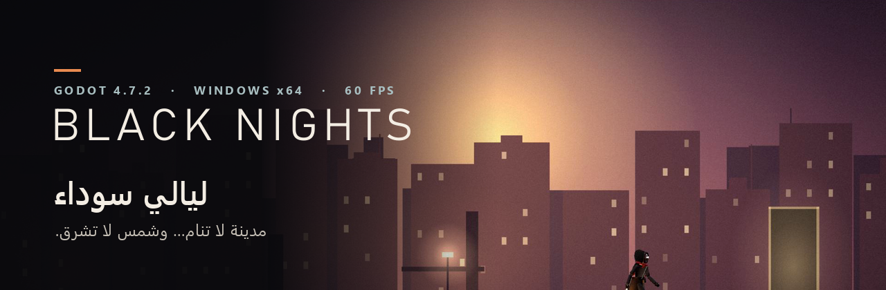
</div>

<div align="center">
  <br>
  
  
  
  
  
  
</div>

<br>

<h2 align="center">مدينة لا تنام… وشمسٌ لا تشرق</h2>

<p align="center">
  <b>لعبة منصّات سينمائية من سبعة فصول.</b><br>
  بطل مغمور، مدينة غرقانة في المطر والحديد، وسبع محطات بتحكي الحكاية<br>
  من غير كلمة حوار واحدة — الضوء والصوت والخطوات هما اللي بيحكوا.
</p>

<p align="center">
  <i>مفيش أنيميشن جاهز، مفيش أصول جاهزة. الكود والرسم والحركة والأصوات — كلهم اتعملوا من الصفر.</i>
</p>

<br>

<div align="center">
  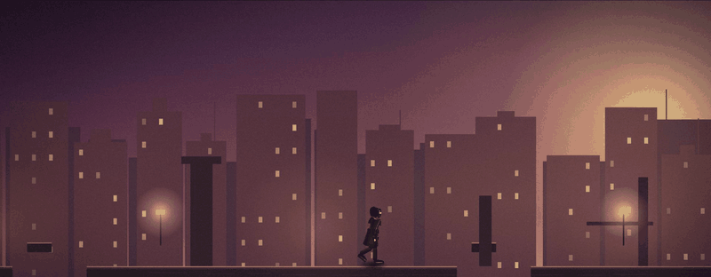
  <br>
  <sub>الفصل السابع — فجر كاذب · لقطة من اللعب الفعلي</sub>
</div>

<br>

## ⚡ في لمحة

| البند | التفاصيل |
|:--|:--|
| 🎮 **المحرك** | Godot 4.7.2 — Compatibility renderer |
| 🧩 **الحجم** | 7 فصول · 10 مشاهد جاهزة · 28 سكريبت |
| 🧠 **الكود** | 4,848 سطر GDScript — من غير أي إضافة خارجية |
| 🔊 **الصوت** | 86 ملف صوتي (أجواء، موسيقى، مؤثرات) — كلهم مولّدين برمجياً |
| 🖥️ **الشاشة** | 1920×1080 · stretch: `canvas_items` · فلتر Nearest · 60 FPS |
| 🪟 **المنصّة** | Windows x86_64 — بيلد جاهز + مصدر كامل |

<br>

## 🌒 الفصول السبعة

<div align="center">
  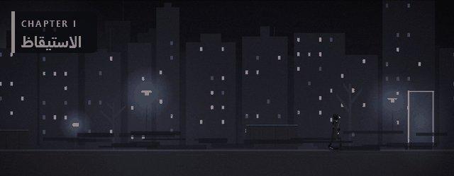
</div>

<br>

| # | الفصل | المكان | الفكرة |
|:-:|:--|:--|:--|
| I | **الاستيقاظ** | أسطح المدينة | أول ضوء… وأول خطوة. مشي وقفز ومدينة نايمة تحتك |
| II | **الطوفان** | شوارع غرقانة | المية بتبلع الشوارع، وأنت بتتعلم تطفو وتقاوم التيار |
| III | **المصنع** | منصات ومكابس | كل حاجة بتتحرك في نفس الوقت — التوقيت هو المفتاح |
| IV | **الأنفاق** | ظلام كامل | مفيش حاجة شايفها غير اللي الفانوس بيلمسه |
| V | **البرج** | صعود رأسي | سبع طبقات… والطريق كله لفوق |
| VI | **المختبر** | أشعة وممرّات | شعاع واحد غلط، والتجربة تنتهي |
| VII | **فجر كاذب** | آخر المدينة | الشمس بتشرق… لكن المدينة لسه نايمة |

<br>

## 🖼️ لقطات من اللعبة

<table>
  <tr>
    <td width="33.3%">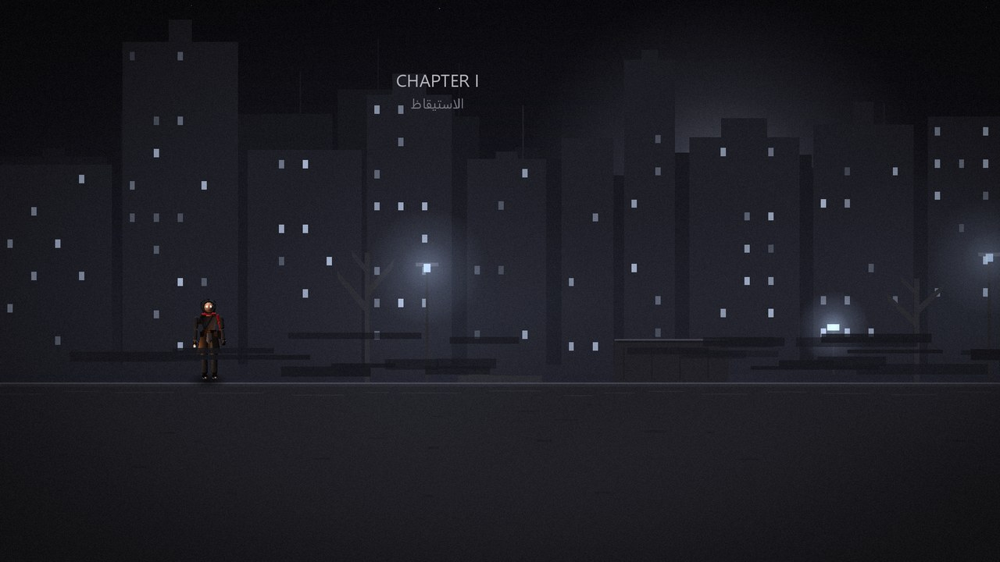<br><sub><b>I</b> — الاستيقاظ</sub></td>
    <td width="33.3%">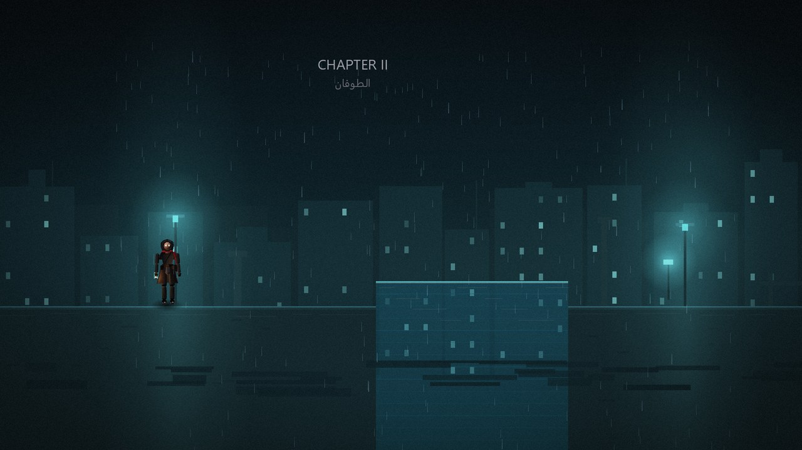<br><sub><b>II</b> — الطوفان</sub></td>
    <td width="33.3%">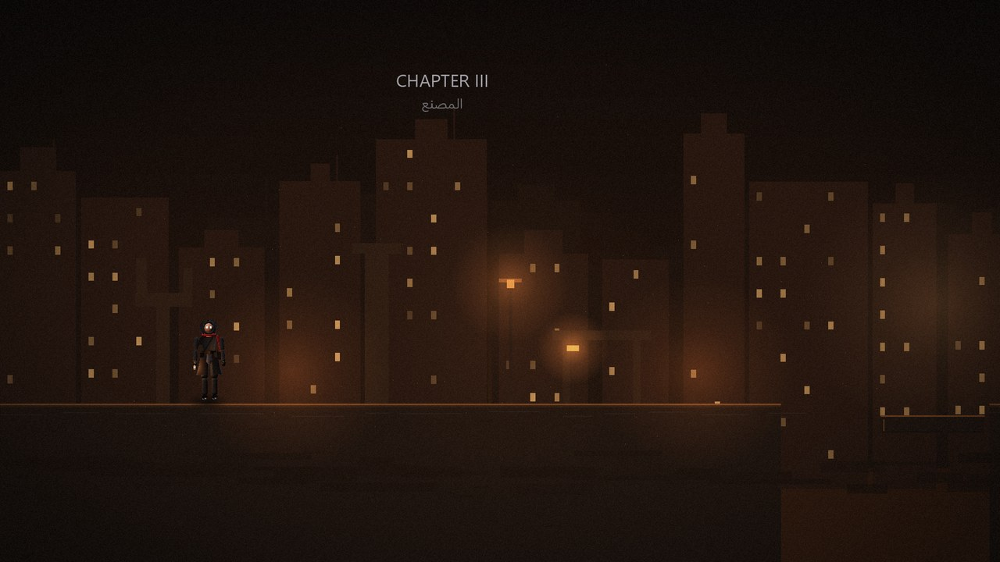<br><sub><b>III</b> — المصنع</sub></td>
  </tr>
  <tr>
    <td width="33.3%">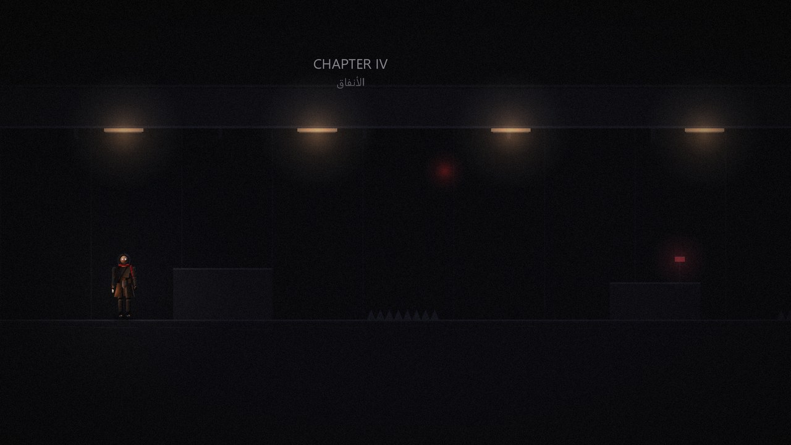<br><sub><b>IV</b> — الأنفاق</sub></td>
    <td width="33.3%">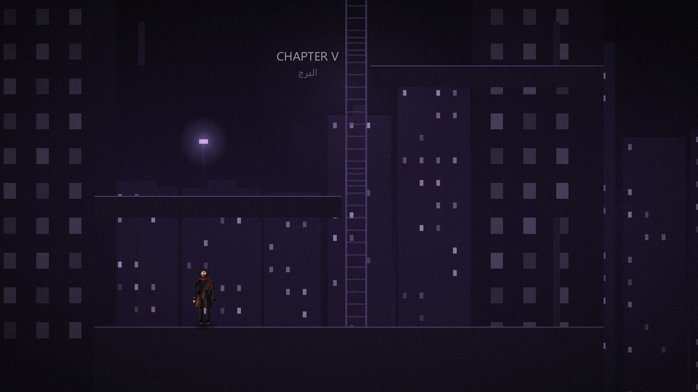<br><sub><b>V</b> — البرج</sub></td>
    <td width="33.3%">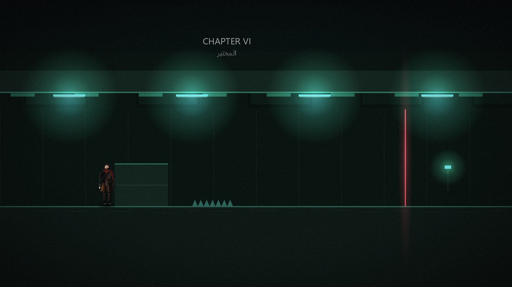<br><sub><b>VI</b> — المختبر</sub></td>
  </tr>
</table>

<div align="center">
  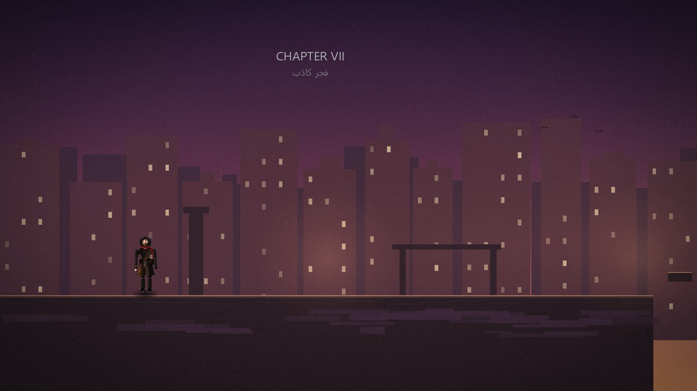
  <sub><b>VII</b> — فجر كاذب · النهاية</sub>
</div>

<br>

## 🧠 جوّه المحرك

<div align="center">
  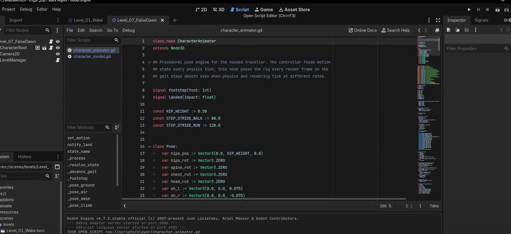
</div>

<br>

<table>
  <tr>
    <td width="50%" valign="top">
      <h4>🧍 بطل ثلاثي الأبعاد في عالم ثنائي</h4>
      الشخصية موديل Low-poly اتبنى بالكود من شرائح ومنحنيات وقت التحميل،<br>
      وبتتحرك جوّه <code>SubViewport</code> بكاميرا <code>Orthographic</code> —<br>
      عشان اللعب يفضل 2D، بس الإحساس يبقى مسرحي وعميق.
    </td>
    <td width="50%" valign="top">
      <h4>🦿 محرك حركة مكتوب من الصفر</h4>
      مفيش ملفات أنيميشن جاهزة. محرك الوضعيات بيحسب كل مفصل كل فريم:<br>
      مشي، جري، قفز، سباحة، تسلق، تعب — مع تمايل الشال، ووقع الخطوات،
      وانتقالات ناعمة بين الحالات.
    </td>
  </tr>
  <tr>
    <td width="50%" valign="top">
      <h4>🏙️ مدينة مرسومة بالكود</h4>
      المباني، الأسطح، أعمدة النور، والدخان — كلهم بيتولّدوا برمجياً<br>
      في ثلاث طبقات Parallax، وكل فصل له لوحته اللونية وإيقاعه.
    </td>
    <td width="50%" valign="top">
      <h4>🎧 صوت بيحس باللعب</h4>
      86 صوت مولّدين برمجياً — مطر، رياح، ماكينات، أشعة، خطوات —<br>
      بيمرّوا على <code>AudioManager</code> موحّد بيمزجهم حسب المكان والحالة.
    </td>
  </tr>
</table>

<br>

## 🎮 التحكم

| المفتاح | الحركة |
|:--:|:--|
| **A / D** أو **← →** | مشي يمين وشمال |
| **Space** | قفز |
| **Shift** | جري |
| **W / S** | تسلق السلالم والسباحة |
| **E** | تفاعل |
| **Esc** | إيقاف مؤقت |

<br>

## ⚙️ المواصفات

| البند | القيمة |
|:--|:--|
| المحرك | Godot **4.7.2** stable |
| الـ Renderer | **GL Compatibility** (بيشتغل على أي لابتوب) |
| الدقة | **1920×1080** — stretch mode: `canvas_items` |
| الإطارات | **60 FPS** ثابتة |
| فلتر النسيج | **Nearest** |
| المنصّة | **Windows x86_64** |
| الحفظ | حفظ تلقائي عند نهاية كل فصل + إعدادات + قائمة إيقاف |

<br>

## 🚀 التشغيل

**① النسخة الجاهزة — Windows**

> في حزمة الإصدار، فولدر `BUILD` فيه `BlackNights.exe` و `BlackNights.pck`.
> دبل كليك على الـ exe وخلاص — مفيش تثبيت ومفيش Godot.

**② من المصدر — Godot 4.7.2**

> افتح `project.godot` من المستودع في Godot، ودوس **F5**.
> لو عايز تصدّر بيلد جديد: **Project ▸ Export ▸ Windows Desktop**
> (الـ preset موجود جاهز باسم `Windows Desktop`).

<br>

## 📁 هيكل المستودع

```text
BlackNights/
├── project.godot            # إعدادات اللعبة والـ Input Map
├── export_presets.cfg       # preset تصدير Windows
├── scenes/
│   ├── levels/              # الفصول السبعة
│   ├── player/              # CharacterRoot — البطل
│   └── ui/                  # القائمة الرئيسية + الإعدادات
├── scripts/
│   ├── levels/              # level_base, level_kit, hazards, water…
│   ├── player/              # controller + animator + model
│   ├── systems/             # save, audio, level manager
│   ├── ui/
│   └── dev/                 # أدوات تصوير واختبار
├── resources/               # مكتبة أفعال الشخصية والمواد
├── assets/
│   ├── audio/               # 86 ملف — ambience / music / sfx
│   └── video/               # خلفيات الفصول
└── docs/media/              # صور وجيفات الـ README
```

<br>

## 🎬 الفيديو

<div align="center">
  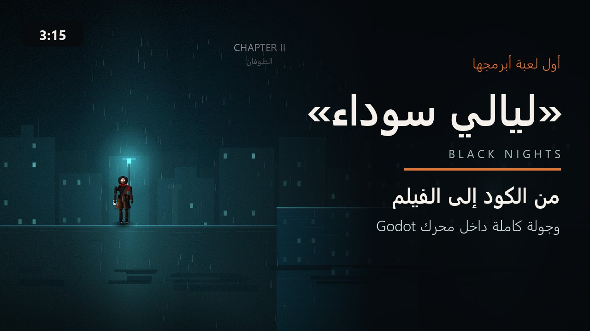
  <br>
  <sub>النسخة السينمائية (3:15) — فيلم اللعبة + جولة كاملة جوّه محرّك Godot</sub>
  <br>
  <sub>▶️ ضيف رابط اليوتيوب هنا قبل النشر</sub>
</div>

<br>

---

<div align="center">
  <sub><b>BLACK NIGHTS</b> — كل الكود، الرسم، الحركة، والصوت اتعملوا من الصفر.</sub>
  <br>
  <sub>صُنعت بالليل على Godot 4 · v1.0</sub>
</div>
